# Newsroom architecture

Newsroom is a TypeScript strict Next.js App Router application for a small editorial workspace. It starts with no news stories, no Canva templates, and no connected providers. Seeded publisher profiles and portal styles are editable records, not a simulated live newsroom.

## Runtime

- React, Tailwind CSS, Radix-based shadcn-style Button/Dialog primitives, React Hook Form with Zod, TanStack Query, and Sonner implement the workspace.
- `src/lib/commands.ts` is the validated mutation boundary. Every server mutation verifies a Supabase user, resolves workspace membership, enforces editor/owner permissions, verifies its origin, and validates runtime input.
- `src/lib/store.ts` serializes each workspace with a PostgreSQL row lock. A Zod-validated workspace document is authoritative; named relational projections are refreshed in the **same transaction**. Composite foreign keys enforce tenant relationships for stories, editions, and publications. Client reads use RLS; credentials and aggregate documents are server-only.
- The bounded aggregate is deliberately simple for a private owner. Reads currently rebuild projections too. Before larger SaaS scale, separate read paths, split aggregates, paginate the API, and replace full projection refreshes with incremental SQL. Do not advertise this version as a large-scale SaaS deployment.
- An explicitly selected `NEWSROOM_MODE=sandbox` uses an atomic local JSON store and directory lock, bypassing authentication. It is for private local evaluation only. It does not validate Supabase login. Processes sharing a sandbox must share `DATA_DIR`.

## Editorial pipeline

```mermaid
flowchart LR
  S[Permitted source / manual import] --> D[Canonical dedupe / heuristic event cluster]
  D --> F[Claim ledger with attributed evidence]
  F --> L[Editor locks factual version]
  L --> E[English / Bangla portal editions]
  E --> C[Consistency warnings + human review]
  C --> G[Graphic / licensing review]
  G --> A[Explicit approval]
  A --> J[Durable publication queue]
  J --> M[Manual action until provider adapter validated]
  M --> P[Editor-reported real post URL]
```

Original source URLs and imported report text are retained in source items. Similar headline tokens are an **event-clustering heuristic**, not an embedding model or proof of independent corroboration. Source priority controls retrieval order, not truthfulness. Editorial interest scores show their rationale and are not labeled objective trends.

Facts are explicitly unverified until an editor supplies evidence. Server-retrieved evidence is recorded and matched on save; editing its excerpt makes it manual evidence. Multiple copies of one wire origin do not count as independent evidence. The software cannot establish whether an editor's declared independent origins are actually independent.

Each portal edition records its fact version and revision. Fact edits unlock the record, invalidate unpublished approvals and graphics, and cancel schedules. Saving article edits records the prior revision, checks unsupported numbers/dates/quotes/source URLs, and invalidates approval. Names and causal meaning require the second model check (when available) and explicit human review; no automated check proves accuracy.

## Jobs and scheduling

The worker is a separate persistent process. Jobs carry run time, attempt count, lease token, lease expiry, idempotency key, progress, and diagnostics. One active job per workspace bounds concurrency. Postgres locks make claims safe across workers. Non-publication failures retry with bounded exponential backoff and jitter, then become dead letters. A lost publication lease becomes ambiguous and is never blindly retried. Manual reconciliation explicitly asks the editor to inspect the destination.

The browser polls progress; it does not run the scheduler. Dhaka local timestamps are converted to UTC on the server. Due publication jobs become `Requires Manual Action` while automatic providers are disabled; nothing is posted to Facebook, Instagram, or Buffer by these jobs.

## Graphics and storage

The original built-in SVG layout is rasterized to a real PNG by Sharp. Noto Sans Bengali is installed in Docker. Text-fitting estimates are conservative and require final visual review. Approved uploaded imagery is cropped with an editor-defined focal point, separate from headline text. AI illustrations receive a visible label. Imagery licenses and expiry are editorial declarations, not a license-verification service.

Production media uses a **private** Supabase Storage bucket, accessed server-side; authenticated media routes enforce workspace ownership. Sandbox media stays under `.data/media`. Credentials are encrypted with AES-256-GCM using an external 32-byte key. The key and Supabase service role must remain server-only.

## Provider boundaries

OpenAI implements a known Responses API contract with Zod structured output and a second consistency request; the current documentation was unavailable in this environment, so this assumption still requires live validation. Canva/Meta/Buffer are capability-gated configurable contracts with no guessed default endpoint paths. OAuth includes random state and PKCE, but provider-specific token exchange requirements must be verified before enabling a contract. Automatic social publishers remain intentionally disabled. See INTEGRATIONS.md.

The service worker caches only an icon and an offline page. It never caches authenticated HTML, stories, API responses, credentials, or article drafts.
