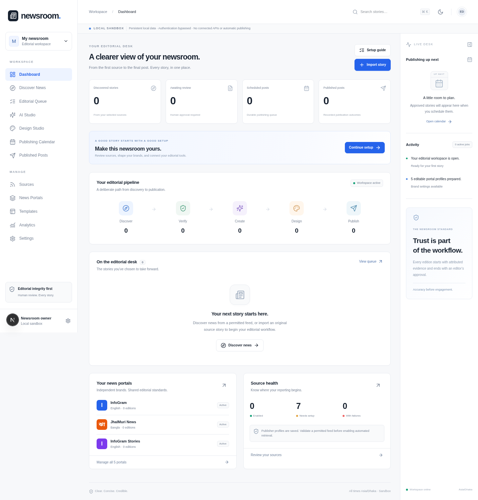

# Newsroom

A private editorial workspace for a Bangladesh-based publisher: discover permitted news, review attributed evidence, create English/Bangla portal editions, render graphics, approve, schedule, and complete publishing with a transparent manual fallback.

**Status:** working local application, with important external-provider and automation limitations. See [KNOWN_LIMITATIONS.md](KNOWN_LIMITATIONS.md) before deployment. No external integration is presented as connected without a successful live test.

## View the interface



The screenshot shows the actual local application with no invented news or connected integrations.

## Get the project

On this GitHub branch, choose **Code → Download ZIP**, extract it, and open a terminal in the extracted project folder. Alternatively, clone this branch with Git. Node.js 24 is required for the commands below. This repository contains application source; GitHub itself does not host the running Next.js app or background worker.

## Run locally

Requirements: Node.js 24, npm, and Bengali fonts (Noto Sans Bengali recommended).

```bash
npm ci
cp .env.example .env.local
npm run dev
```

In a second terminal, from the same checkout:

```bash
npm run worker
```

The sample environment explicitly enables a **private local sandbox**: authentication is bypassed and data persists under `.data`. Keep it on a trusted machine. It starts with no news stories and no Canva templates. Five editable portals and seven disabled/awaiting-confirmation source profiles are prepared.

Use Import story for authorized source text, select it in Discover News, review and save factual claims and evidence, lock the record, then Generate News → Manual bilingual draft. Complete both languages in AI Studio, save, generate a graphic from a registered built-in template, visually review it, approve the edition, and prepare/schedule a manual publication. Copy/download, publish yourself, then record the actual post URL and ID. Such posts are labeled editor-reported, not API-verified.

For real permitted feeds, Sources → Discover feeds validates actual published links; choose a feed and enable it, then Discover News → **Scrape News**. Failures are recorded by source. The worker must run for background generation and schedules.

## Checks

```bash
npm run typecheck
npm run lint
npm test
npm run build
npm run test:e2e
```

Playwright uses Chromium at `/usr/bin/chromium` by default. Set `CHROMIUM_PATH` to your installed browser, or install Playwright Chromium and set the executable path. See [TESTING.md](TESTING.md) for real Postgres/RLS checks, mocked API boundaries, and browser test details.

## Docker

```bash
cp .env.example .env
# Edit POSTGRES_PASSWORD; sandbox mode is local only.
docker compose up --build
```

Compose starts PostgreSQL, migration runner, web app, and durable worker. It binds web and database ports to localhost. For production, use Supabase Auth and private Storage, set production mode, use a secure server database connection, and configure HTTPS. Public Supabase build arguments must be present when building the browser bundle.

## Production configuration

Required: `NEWSROOM_MODE=production`, `APP_URL`, Supabase public URL/anon key, server service role, `DATABASE_URL`, a stable 64-character hex `ENCRYPTION_KEY`, and persistent worker hosting. OpenAI key/model/pricing are optional for manual editing. Canva, Meta, and Buffer are optional and capability-gated.

```bash
npm run db:migrate
npm run build
npm start
# Separate persistent process:
npm run worker
```

`npm start` serves the prepared standalone build with its static/public assets; Docker uses the same standalone artifact. Never expose sandbox mode or service-role credentials. See [DEPLOYMENT.md](DEPLOYMENT.md).

## Files and modules

- `src/components`: responsive dashboard, managers, onboarding, editor, image licensing, calendar, integrations.
- `src/app/api`: authenticated state/mutations, media/upload, OAuth, template tests, health.
- `src/lib`: schemas, transaction store, evidence/editorial checks, adapters, SSRF controls, PNG renderer, jobs.
- `supabase/migrations`: tenant schema/RLS and private Storage setup.
- `scripts`: migration runner and durable worker.
- `tests`: unit, local integration, actual PostgreSQL/RLS, Testing Library, and Playwright scenarios.

Read [ARCHITECTURE.md](ARCHITECTURE.md), [INTEGRATIONS.md](INTEGRATIONS.md), [DEPLOYMENT.md](DEPLOYMENT.md), [TESTING.md](TESTING.md), and [KNOWN_LIMITATIONS.md](KNOWN_LIMITATIONS.md).
